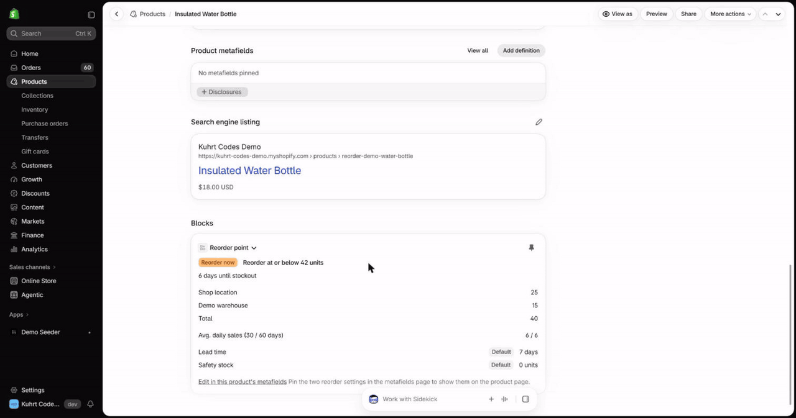

# Reorder Point

A block on the product page of the Shopify admin that shows how fast a product sells, how long its stock will last, and the stock level at which to reorder it, worked out from the store's own orders.

## The problem

A merchant who reorders too late runs out of stock, and one who reorders too early ties up cash. Shopify shows stock and a sales report, but not the point at which to reorder a given product. This block answers that on the product page, with a formula short enough to check by hand. It is an extension-only app: no server, no database.

### How each figure is worked out

- **Average daily sales** are net units sold per day over the complete days before today, in the shop's time zone. The block shows two: **30 days** and **60 days**. Days without sales count as zero. A refund or order edit reduces the units on the day the order was placed, and cancelled orders are left out. The 30-day average drives the forecast; the 60-day one is there so you can see a slowdown or a spike.
- **Reorder point** = `ceil(avg30 × lead time + safety stock)`. Lead time is the days between ordering and the stock arriving. It defaults to 7 and accepts 0 to 365. Safety stock defaults to 0 units and accepts 0 to 100,000. Both are product metafields.
- **Days until stockout** = `floor(available / avg30)`, with `available` summed over every location of every tracked variant. It is 0 when nothing is available. When the 30-day average is 0 there is no estimate, and the reorder point equals the safety stock.
- **Status**, from the stock available and the reorder point:

  | Status       | When                                |
  | ------------ | ----------------------------------- |
  | Out of stock | 0 or fewer available                |
  | Reorder now  | at or below the reorder point       |
  | Low          | at or below 1.5 × the reorder point |
  | Healthy      | above 1.5 × the reorder point       |

For example, a product that sells 6 a day with the default 7-day lead time has a reorder point of `6 × 7 + 0 = 42`. With 40 units available it is **reorder now**, with `floor(40 / 6) = 6` days left. A block that shows an average, a lead time and a safety stock lets you reproduce its reorder point from these lines. The block rounds the average to two decimals for display, so at long lead times a hand check from the shown figure can come out one unit low; the exact form is `ceil(units sold in the last 30 days / 30 × lead time + safety stock)`.

### What it does not account for

- **Incoming stock and purchase orders.** It only sees what is on hand.
- **Seasonality and trend.** Beyond showing both averages there is no model.
- **A product launched inside a window.** Each average divides by the full window, so a product that is 10 days old has an under-estimated average until the window fills.
- **Variants and locations.** Settings apply to the product, not to a variant or a location, and sales are summed over all variants.
- **Orders older than 60 days.** The window is 60 days, not 90, because reading older orders needs `read_all_orders`, which Shopify approves case by case. Orders are visible by when they were created, so the oldest day's sales may be partly missing. A refund of an order placed before the window isn't seen at all.
- **Very large histories and catalogues.** The block reads at most 3,000 orders from the last 60 days. When every variant has a SKU, those are the orders containing one of the product's SKUs (a SKU shared with another product counts that product's orders too). When any variant has none, it is any 3,000 orders in the store. Past that, the block says so instead of showing a figure computed from part of the data. A product with more than 100 variants, or a variant stocked at more than 20 locations, shows an error instead.

### Relationship to Restock Mate

The days-until-stockout formula and the status thresholds are taken from Restock Mate, my inventory alert app. What differs is how sales are measured. Restock Mate infers them from day-over-day drops in stock in nightly snapshots, which needs a backend and miscounts a day with both a restock and sales. This sample reads the orders the store already has, so it works from the day it is installed and leaves out refunded units and cancelled orders. It drops Restock Mate's rule that also marks "reorder now" when days until stockout is within the lead time: with a computed reorder point it never adds a case.

### Where it can be installed

Reading orders needs protected customer data, which Shopify grants only to an app with a distribution method. This app uses custom distribution, which grants Level 1 access with no review but ties an app to one store, or to stores in one Plus organization. It runs on any Shopify plan: the Plus restriction applies to Functions, and this app has none. Another store needs another app from the same code.

A public App Store listing would need a separate app with public distribution, plus:

- a protected customer data request explaining why it reads orders;
- App Store review;
- the mandatory compliance webhooks. These need an HTTPS endpoint that verifies Shopify's signature, so the app would need a hosted backend. [Script Tag to App Embed](../script-tag-migration/README.md) shows that shape.

## Demo



The demo data comes from a script. It runs as a separate app, Demo Seeder, because Reorder Point only reads, and creating orders (`orderCreate`) needs an offline app token and write scopes. Create one seeder app per store:

1. Link a config named after your store's handle, so the file is `shopify.app.your-dev-store.toml`, and give it the scopes of `tools/demo-seeder/shopify.app.kuhrt-codes.toml` (`write_products`, `write_inventory`, `write_locations`, `write_orders`):

   ```sh
   pnpm --filter reorder-point exec shopify app config link --path ../../tools/demo-seeder
   ```

2. Deploy its config:

   ```sh
   pnpm --filter reorder-point exec shopify app deploy --path ../../tools/demo-seeder -c your-dev-store
   ```

3. In the Partner Dashboard, give that app custom distribution to your store and install it from the link.

Then run the setup, which stops with exit 2 before any store call when there is no config for the store:

```sh
pnpm --filter reorder-point demo:setup --store your-dev-store.myshopify.com
```

The first run takes about 15 minutes. It creates one order per day for the last 60 days, paced to stay under the order creation limit, and a stopped run resumes when you run it again. Running it again the same day creates nothing; on a later day it adds orders only for the days since. Every run resets the demo products' stock to the designed numbers. It adds a location ("Demo warehouse") only when the store has fewer than two.

It creates four products, handles `reorder-demo-water-bottle`, `reorder-demo-tote-bag`, `reorder-demo-desk-planter` and `reorder-demo-winter-gloves`, and orders tagged `reorder-demo`. With the default settings they show reorder now, healthy, healthy and low. To remove the demo data in the admin, cancel and then delete the orders tagged `reorder-demo`, delete the four products, and deactivate "Demo warehouse" if the setup added it.

Orders are backdated from the day the setup runs. The winter gloves sold 8 a day until a month ago and 1 a day since; as the high days age out of the 60-day window that shape fades, so re-run the setup on a fresh store to restore it.

The seeder's scopes are the seeder's, not the app's.

## Shopify features shown

- **Admin block UI extension** on the product details page (`admin.product-details.block.render`), with Polaris web components and Preact
- **Admin GraphQL from the extension** through the direct API, running as the signed-in staff member, with no backend
- **App-owned product metafield definitions** with merchant read and write access, holding the lead time and safety stock
- **Protected customer data, Level 1**, granted by custom distribution, for the `orders` query
- **Extension-only app**: no server, no database

## Architecture

```
    shared/reorder-settings.ts          shared/forecast.ts
    (metafield values -> settings)      (daily sales -> figures, status)
                    \                        /
                     v                      v
        reorder-point-block (admin block, product page)
           ^                  ^                    ^
           | variants,        | orders, last       | lead time and
           | stock by         | 60 days, netted    | safety stock
           | location         | per day            |
           +--- Admin GraphQL (direct API) --------+
                                   |
        product metafields $app/lead-time, $app/safety-stock
        (edited by the merchant under "View all")

   Demo only: demo-setup --> shopify app execute --> Demo Seeder
              (products, stock, 60 days of orders)
```

| Folder                                                               | What's in it                                                                    |
| -------------------------------------------------------------------- | ------------------------------------------------------------------------------- |
| [`shared/`](shared/)                                                 | The forecast maths and the settings parsing, with no clock and no Shopify calls |
| [`extensions/reorder-point-block/`](extensions/reorder-point-block/) | The block: its queries, the data loading and the component                      |
| [`../../packages/admin-query/`](../../packages/admin-query/)         | Query and paging helpers shared with the other admin extension in this repo     |
| [`scripts/demo-setup/`](scripts/demo-setup/)                         | The idempotent demo data setup                                                  |
| [`../../tools/demo-seeder/`](../../tools/demo-seeder/)               | The Demo Seeder app configs, one per store                                      |

## Run locally

Prerequisites are in the [root README](../../README.md#prerequisites). Then:

```sh
git clone https://github.com/Kuhrt/kuhrt-codes-shopify-examples.git
cd kuhrt-codes-shopify-examples/apps/reorder-point
pnpm install
pnpm config:link
pnpm dev --store your-dev-store.myshopify.com
```

`pnpm install` installs the whole workspace. `pnpm config:link` connects the code to an app in your own Partner organization (choose to create a new one). The `shopify.app.*.toml` it writes may not include the `[access.admin]` and `[product.metafields.app.*]` sections. If it doesn't, copy them over from `shopify.app.toml`: without them the block can't query the store and the settings have no definitions. `pnpm test` checks every app config for them. The block shows no sales until that app has a distribution method, because Shopify withholds order data from an app without one: in the Partner Dashboard, choose custom distribution to your development store. Install the app, open a product, and add **Reorder Point** from the page's app blocks menu, then pin it. `pnpm dev` builds the extension and starts a dev preview on your store.

Lead time and safety stock are product metafields, kept out of the block so it only reads. On a product, open the metafields card, choose **View all**, and edit them there. Pin them to see them on the card.

## Deploy

```sh
pnpm app:deploy --config production
```

This releases a version with the app configuration, the metafield definitions and the block. `shopify.app.production.toml` is the deployed app, tied to the demo store, and `shopify.app.toml` stays the development app.

## Tests

`pnpm check` from the repository root runs the full suite. It covers:

- unit tests for the forecast and settings maths, including zero sales, refunds, untracked stock and invalid settings;
- the block's data layer (paging, refund netting, time zones) and component states, run without a store;
- the demo setup's steps, pacing and retries against a fake store, and a test that each demo product's designed status comes out of the forecast code;
- the contract tests, which compare the scope table below and the metafield definitions with every app configuration.

## Access scopes

| Scope            | Why                                                                                                             |
| ---------------- | --------------------------------------------------------------------------------------------------------------- |
| `write_products` | Shopify requires it to declare the product metafield definitions. It also covers reading products and variants. |
| `read_inventory` | Stock available per variant and location.                                                                       |
| `read_locations` | Location names, shown beside each location's stock.                                                             |
| `read_orders`    | The units sold per day. Needs protected customer data Level 1, which custom distribution grants.                |

`read_all_orders` is not requested, which is why the windows are 30 and 60 days. The demo setup's scopes belong to the Demo Seeder app, not to this one.

## Need something like this built?

[Work with me](https://shopify.kuhrt.codes/work-with-me).
